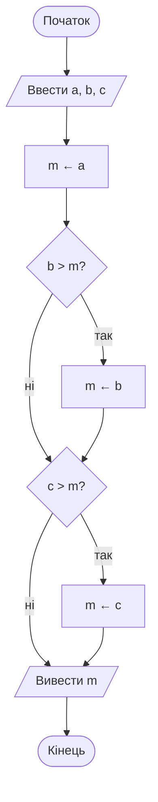
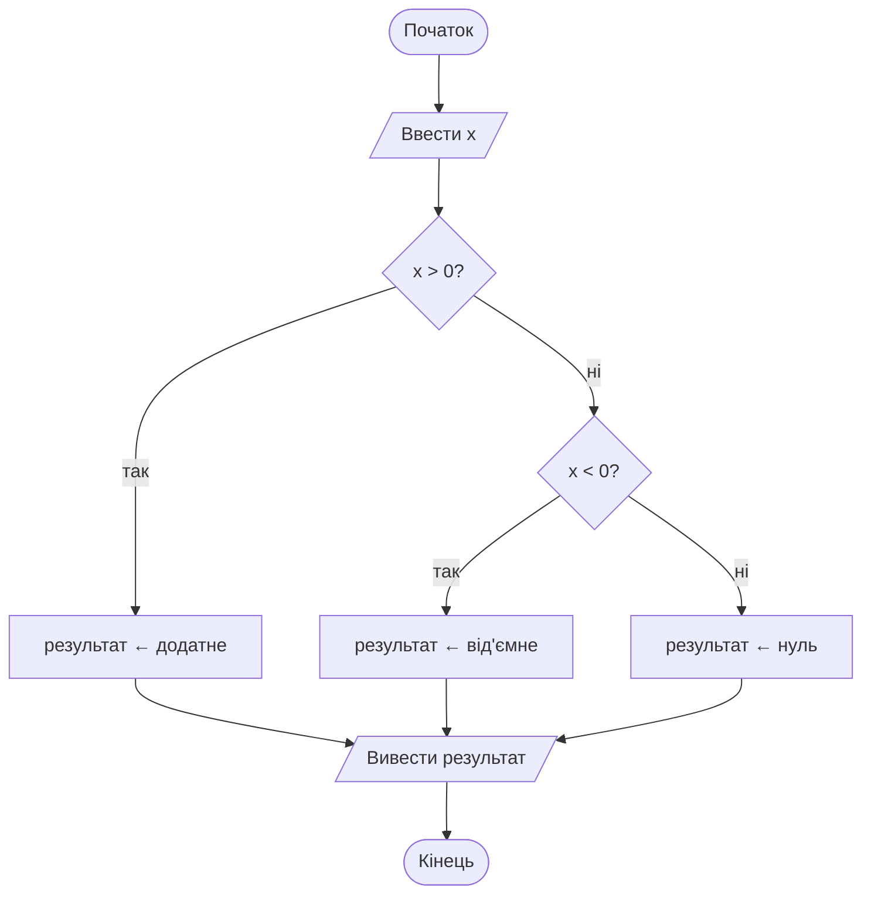
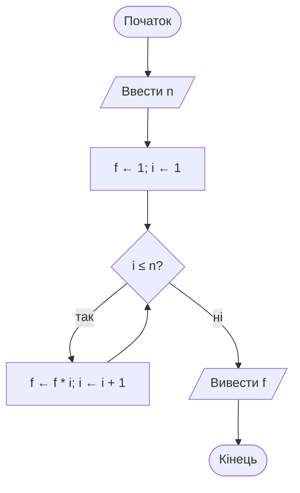
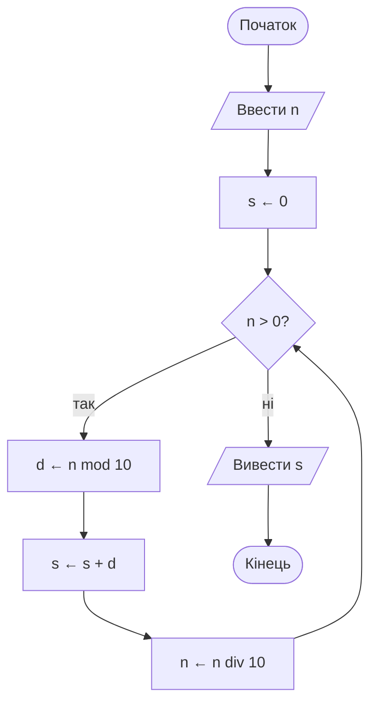
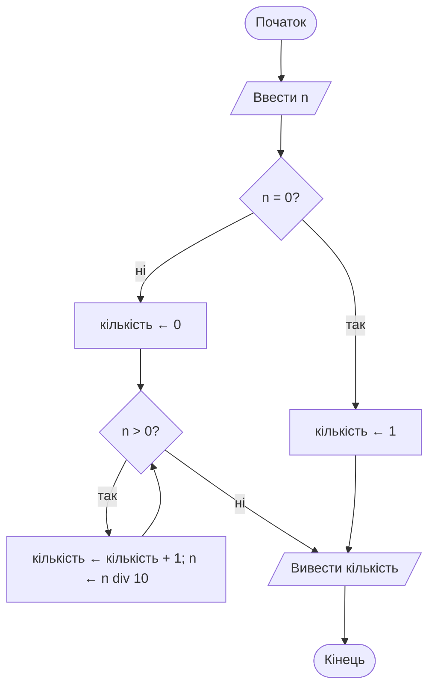
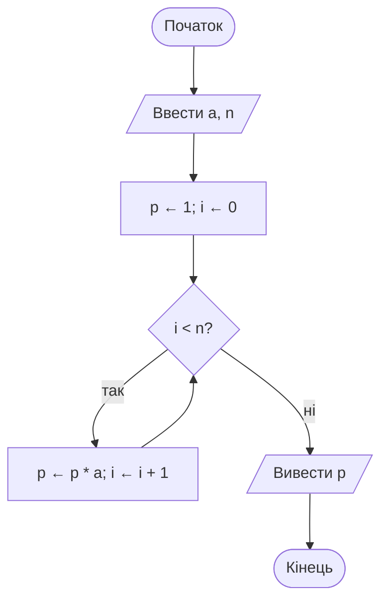
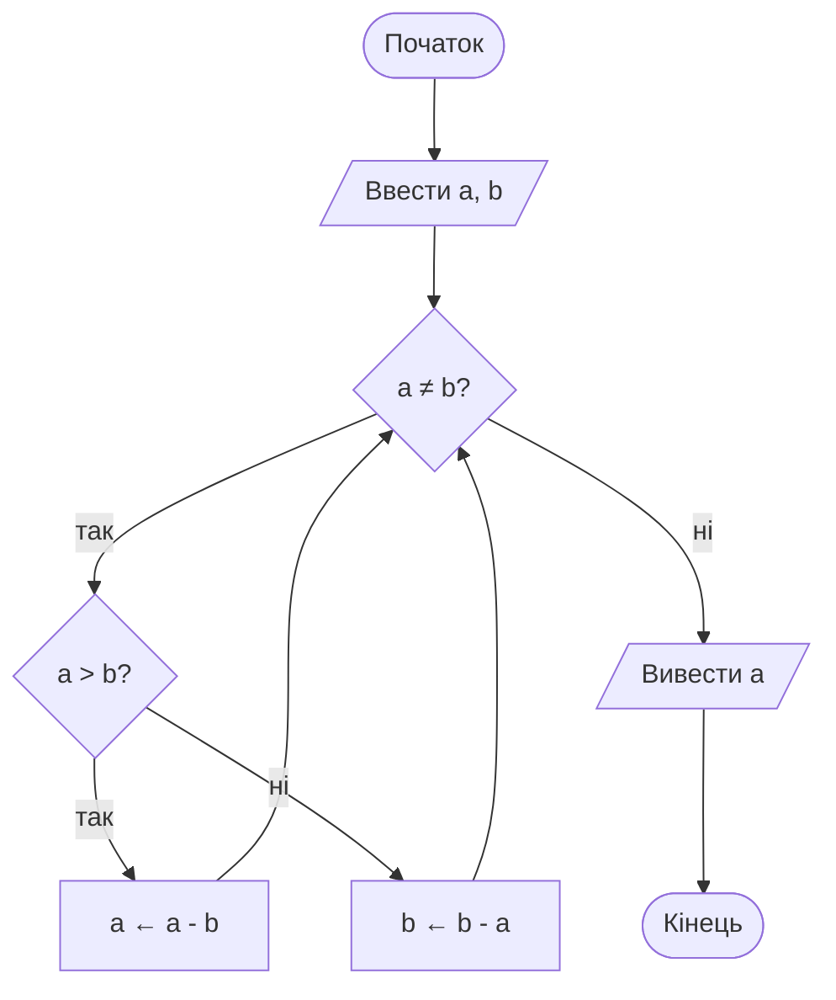
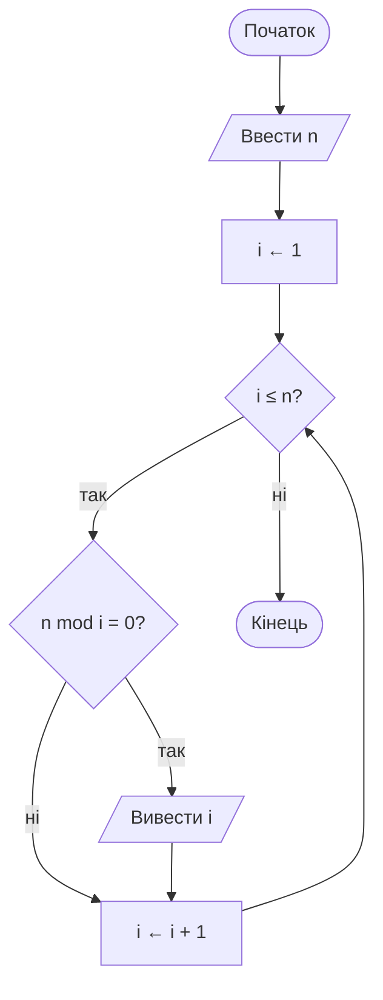
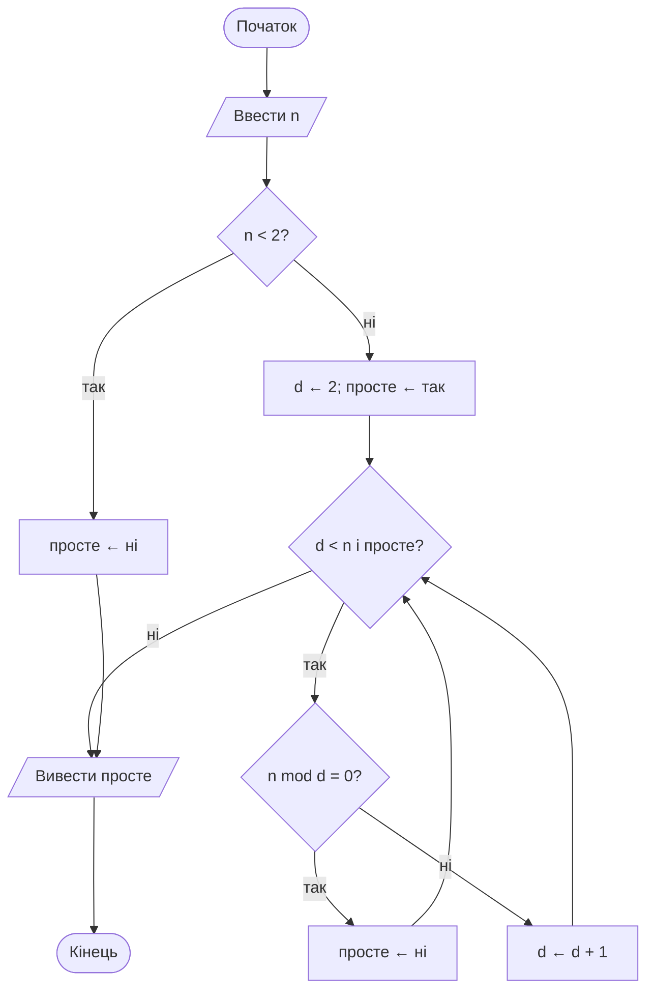
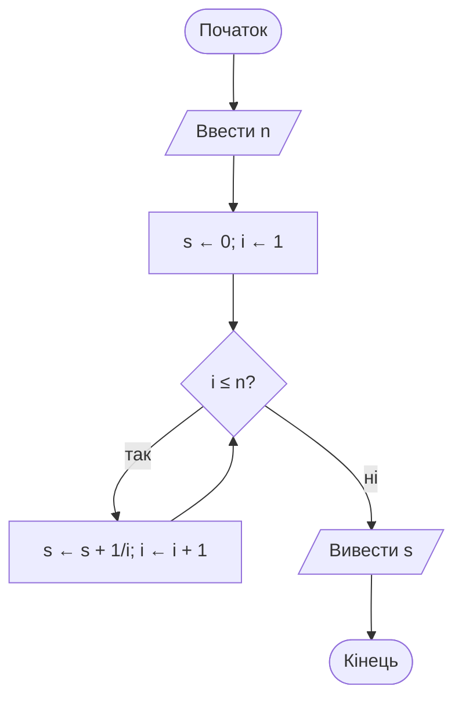

# Розділ 2. Блок-схеми та псевдокод — розв'язання

Блок-схеми подано у Mermaid: GitHub відображає їх як діаграми. У псевдокоді `←` означає присвоєння, `mod` — остачу від ділення, `div` — цілу частку.

## 2.1 Максимум із трьох чисел; тест `(5, 9, 2)`



**Псевдокод**
```text
ПОЧАТОК
  ВВЕСТИ a, b, c
  m ← a
  ЯКЩО b > m ТО m ← b ВСЕ
  ЯКЩО c > m ТО m ← c ВСЕ
  ВИВЕСТИ m
КІНЕЦЬ
```

**Таблиця трасування**

| Крок | `b > m` | `m` після перевірки `b` | `c > m` | `m` після перевірки `c` |
|---|---|---:|---|---:|
| 0 — початок | — | 5 | — | 5 |
| 1 | `9 > 5` — так | 9 | — | 9 |
| 2 | — | 9 | `2 > 9` — ні | 9 |

Вивід: `9`.

## 2.2 Знак числа; тест `−7`



**Псевдокод**
```text
ПОЧАТОК
  ВВЕСТИ x
  ЯКЩО x > 0 ТО
    результат ← «додатне»
  ІНАКШЕ ЯКЩО x < 0 ТО
    результат ← «від'ємне»
  ІНАКШЕ
    результат ← «нуль»
  ВСЕ
  ВИВЕСТИ результат
КІНЕЦЬ
```

**Таблиця трасування**

| Крок | Умова | Результат перевірки | Дія |
|---|---|---|---|
| 1 | `x > 0` | `−7 > 0` — ні | Перейти до другої умови |
| 2 | `x < 0` | `−7 < 0` — так | `результат ← від'ємне` |

Вивід: `від'ємне`.

## 2.3 Факторіал `n!`; тест `n=5`



**Псевдокод**
```text
ПОЧАТОК
  ВВЕСТИ n  // n ≥ 0
  f ← 1; i ← 1
  ПОКИ i ≤ n ВИКОНУВАТИ
    f ← f * i
    i ← i + 1
  ВСЕ
  ВИВЕСТИ f
КІНЕЦЬ
```

**Таблиця трасування**

| Крок | `i` перед множенням | `f` до множення | `f` після множення | `i` після збільшення | `i ≤ 5` |
|---:|---:|---:|---:|---:|---|
| 0 | 1 | 1 | 1 | 2 | так |
| 1 | 2 | 1 | 2 | 3 | так |
| 2 | 3 | 2 | 6 | 4 | так |
| 3 | 4 | 6 | 24 | 5 | так |
| 4 | 5 | 24 | 120 | 6 | ні |

Вивід: `120`.

## 2.4 Сума цифр натурального числа; тест `1234`



**Псевдокод**
```text
ПОЧАТОК
  ВВЕСТИ n  // n ≥ 0
  s ← 0
  ПОКИ n > 0 ВИКОНУВАТИ
    d ← n mod 10
    s ← s + d
    n ← n div 10
  ВСЕ
  ВИВЕСТИ s
КІНЕЦЬ
```

**Таблиця трасування**

| Ітерація | `n` до кроку | `d = n mod 10` | `s` після додавання | `n` після `n div 10` |
|---:|---:|---:|---:|---:|
| 0 | 1234 | 4 | 4 | 123 |
| 1 | 123 | 3 | 7 | 12 |
| 2 | 12 | 2 | 9 | 1 |
| 3 | 1 | 1 | 10 | 0 |

Вивід: `10`. Для `n=0` сума дорівнює `0`.

## 2.5 Кількість цифр натурального числа; тест `70500`



**Псевдокод**
```text
ПОЧАТОК
  ВВЕСТИ n  // n ≥ 0
  ЯКЩО n = 0 ТО
    кількість ← 1
  ІНАКШЕ
    кількість ← 0
    ПОКИ n > 0 ВИКОНУВАТИ
      кількість ← кількість + 1
      n ← n div 10
    ВСЕ
  ВСЕ
  ВИВЕСТИ кількість
КІНЕЦЬ
```

**Таблиця трасування**

| Ітерація | `n` до кроку | Кількість після збільшення | `n` після `n div 10` |
|---:|---:|---:|---:|
| 0 | 70500 | 1 | 7050 |
| 1 | 7050 | 2 | 705 |
| 2 | 705 | 3 | 70 |
| 3 | 70 | 4 | 7 |
| 4 | 7 | 5 | 0 |

Вивід: `5`. Для `n=0` кількість цифр — `1`.

## 2.6 Обчислити `aⁿ` без оператора степеня; тест `a=3, n=4`



**Псевдокод**
```text
ПОЧАТОК
  ВВЕСТИ a, n  // n ≥ 0
  p ← 1; i ← 0
  ПОКИ i < n ВИКОНУВАТИ
    p ← p * a
    i ← i + 1
  ВСЕ
  ВИВЕСТИ p
КІНЕЦЬ
```

**Таблиця трасування**

| Ітерація | `i` до кроку | `p` до множення | `p` після множення | `i` після збільшення |
|---:|---:|---:|---:|---:|
| 0 | 0 | 1 | 3 | 1 |
| 1 | 1 | 3 | 9 | 2 |
| 2 | 2 | 9 | 27 | 3 |
| 3 | 3 | 27 | 81 | 4 |

Вивід: `81`. Для `n=0` вивід `1`.

## 2.7 НСД за алгоритмом Евкліда з відніманням; тест `(48, 18)`



**Псевдокод**
```text
ПОЧАТОК
  ВВЕСТИ a, b  // a > 0, b > 0
  ПОКИ a ≠ b ВИКОНУВАТИ
    ЯКЩО a > b ТО
      a ← a - b
    ІНАКШЕ
      b ← b - a
    ВСЕ
  ВСЕ
  ВИВЕСТИ a
КІНЕЦЬ
```

**Таблиця трасування**

| Крок | `a` | `b` | Дія |
|---:|---:|---:|---|
| 0 | 48 | 18 | `a > b`, тому `a ← a - b` |
| 1 | 30 | 18 | `a > b`, тому `a ← a - b` |
| 2 | 12 | 18 | `a < b`, тому `b ← b - a` |
| 3 | 12 | 6 | `a > b`, тому `a ← a - b` |
| 4 | 6 | 6 | `a = b`, цикл завершується |

Вивід: `6`. Передумова: обидва числа додатні.

## 2.8 Усі дільники натурального числа; тест `n=12`



**Псевдокод**
```text
ПОЧАТОК
  ВВЕСТИ n  // n ≥ 1
  i ← 1
  ПОКИ i ≤ n ВИКОНУВАТИ
    ЯКЩО n mod i = 0 ТО ВИВЕСТИ i ВСЕ
    i ← i + 1
  ВСЕ
КІНЕЦЬ
```

**Таблиця трасування**

| `i` | `12 mod i` | Дія |
|---:|---:|---|
| 1 | 0 | Вивести 1 |
| 2 | 0 | Вивести 2 |
| 3 | 0 | Вивести 3 |
| 4 | 0 | Вивести 4 |
| 5 | 2 | Нічого не виводити |
| 6 | 0 | Вивести 6 |
| 7 | 5 | Нічого не виводити |
| 8 | 4 | Нічого не виводити |
| 9 | 3 | Нічого не виводити |
| 10 | 2 | Нічого не виводити |
| 11 | 1 | Нічого не виводити |
| 12 | 0 | Вивести 12 |

Вивід: `1 2 3 4 6 12`.

## 2.9 Перевірка простоти; тест `n=21`



**Псевдокод**
```text
ПОЧАТОК
  ВВЕСТИ n
  ЯКЩО n < 2 ТО
    просте ← НІ
  ІНАКШЕ
    d ← 2; просте ← ТАК
    ПОКИ d < n І просте = ТАК ВИКОНУВАТИ
      ЯКЩО n mod d = 0 ТО
        просте ← НІ
      ІНАКШЕ
        d ← d + 1
      ВСЕ
    ВСЕ
  ВСЕ
  ВИВЕСТИ просте
КІНЕЦЬ
```

**Таблиця трасування**

| Крок | `d` | `21 mod d` | `просте` після кроку | Дія |
|---:|---:|---:|---|---|
| 0 | 2 | 1 | так | Збільшити `d` до 3 |
| 1 | 3 | 0 | ні | Знайдено дільник; завершити цикл |

Вивід: `НІ` (21 — складене).

## 2.10 Сума ряду `1 + 1/2 + … + 1/n`; тест `n=4`



**Псевдокод**
```text
ПОЧАТОК
  ВВЕСТИ n  // n ≥ 1
  s ← 0; i ← 1
  ПОКИ i ≤ n ВИКОНУВАТИ
    s ← s + 1 / i
    i ← i + 1
  ВСЕ
  ВИВЕСТИ s
КІНЕЦЬ
```

**Таблиця трасування**

| `i` | Доданок `1/i` | `s` після додавання |
|---:|---:|---:|
| 1 | 1 | 1 |
| 2 | 0.5 | 1.5 |
| 3 | 0.333333… | 1.833333… |
| 4 | 0.25 | 2.083333… |

Вивід приблизно `2.083333`.
